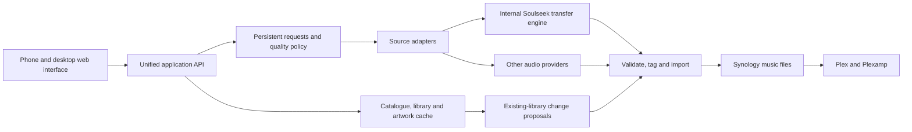

> Historical record. This describes an earlier build. For current requirements, deployment and handover, read [blueprint.md](../../blueprint.md). Do not execute old deployment commands without comparing current operations guidance.

# Phase 1 technical assessment — initial proposal

Prepared 5 October 2026 from the interview, read-only Unraid inspection, and four upstream source checkouts. This is a design proposal, not an implemented or end-to-end validated system. Physical deduplication capability needs isolated validation; private Apple playlist authorisation remains to be resolved.

## Recommended direction

Build a new application around a shared catalogue, library model, persistent acquisition queue, quality profiles, and settings. Reuse selected Music Grabber backend modules, adapt useful album search/matching behaviour from Soularr, and use Lidarr's quality and import behaviour as a reference. Retain an unmodified, pinned slskd engine internally for Soulseek transfers, managed by the application in the same container.

This is one product with one interface and application-owned requests. It does not retain four competing library managers and queues. slskd remains a transfer implementation with its own internal transfer bookkeeping, not a user-facing management service. One container may contain several processes; forcing a single operating-system process would substantially reduce practical reuse across these Python and .NET projects.

Proposed initial stack: Python/FastAPI application and workers, React/TypeScript interface, SQLite on local Unraid appdata, cached artwork on local storage, and music exported to the existing Synology share. These choices fit the inspected code and household scale; dependency versions will be pinned during implementation. No separate Redis or database container is proposed.

## Reuse assessment

| Project | Useful components | Changes required |
| --- | --- | --- |
| Music Grabber | Source adapters, matching, audio validation/provenance, tagging/artwork, album requests, artist monitoring, Apple playlist parsing, acquisition attempt history | Replace mobile interface; extract modules from large application/download files; put all imports and requests behind one domain model and policy |
| Lidarr | Ordered quality profiles, upgrade cutoff, release/recording separation, import and naming semantics | Its .NET services depend on the larger Lidarr application. Copying them into Python is not a plug-in operation; adapt selected algorithms or behaviour rather than keep a second live library manager |
| Soularr | Whole-album peer matching, peer filters, format selection and transfer completion handling | Replace Lidarr polling and import handoff with the unified queue; avoid duplicating artist monitoring and settings |
| slskd | Soulseek connections, searches, peer transfer management and resumable transfer records | Run as an internal engine; map transfers to application jobs; manage health/recovery; expose its configuration through the application's settings |

Evidence: Music Grabber 4.3.0 has matching.py, acquisition.py, albums.py, watched_artists.py, metadata.py and audio_provenance.py. Its application and download files are large and share global settings/database dependencies, so extraction is real refactoring. Soularr's matching functions are coupled to its global Lidarr/slskd clients. Lidarr's Track model distinguishes recording identity and release track identity; TrackFile still contains an AlbumId, which is not a ready-made multi-release physical storage model for this project.

Music Grabber's registry includes YouTube, SoundCloud, zvu4no, FreeMp3Cloud, JioSaavn, Soulseek and Monochrome. Apple Music links supply request metadata, not downloadable Apple subscription audio. Support in source is not proof of present availability or acceptable quality. Source health tests that fetch audio must be kept out of read-only discovery and performed later using controlled, authorised test material.

## Library and download behaviour

Use separate entities for artist, release group, specific release, release track, recording, physical audio asset, and library membership. Track availability must be contextual: a matching title alone is insufficient to mark a specific live recording or compilation track downloaded. External catalogue IDs supplement stable internal IDs so uncatalogued music remains first-class.

Browse the local database and artwork cache immediately. Catalogue refreshes and filesystem scans run in the background. Search local entries first, merge remote entries asynchronously, and preserve useful cached results when providers are unavailable. Distinguish available, queued, downloading, downloaded, partially present, and needs-attention states. Downloaded means a valid imported asset is present; upgrade eligibility is a separate status. Mount outages must not be interpreted as mass deletions.

Requests preserve selected recording/release context and have an idempotency key. Artist requests expand by chosen release types; monitoring is optional per artist. Apple playlist submission is once-only, without playlist export/synchronisation. Apple Music migration first inventories, compares against local assets and presents a retained-music selection; only selected missing items become download requests. The queue stores source attempts, reasons for rejection, retries and final imported asset mappings. Multiple source attempts remain one visible request.

Migration review has artist/release groups and a separate multi-artist compilation-album section, with individual tracks selectable. Single-artist best-of/greatest-hits releases stay under their artist. The main library artist grid excludes artists represented solely on multi-artist compilations, while search and compilation track lists retain those artists. Keep album-artist and track-artist roles distinct; do not achieve this display rule by rewriting credits or discarding associations. Apple's Compilation flag is a hint, not the classification rule; guest credits alone also do not imply a compilation.

Quality profiles rank allowed codec/quality tiers, define an upgrade cutoff and permit upgrades optionally. Validate actual output and retain original source provenance; converting lossy audio to FLAC or increasing its bitrate does not count as a quality upgrade. Whole-album Soulseek matching and per-track fallback share this policy.

Existing-library ingestion first indexes without modifications, then prepares reviewable release matches, tag changes and target paths. Apply only approved proposals with collision checks, a journal and recoverable originals. New-download imports can proceed automatically under configured rules. Stage incomplete files outside Plex's scanned library and publish only verified outputs. A restart during transfer, tagging or export must be recoverable without duplicate requests or half-imported albums.

Removal of artists, albums and tracks is in phase 1 and uses recoverable trash. Record intentional removal separately from accidental file loss, cancel related queued work and prevent automatic reacquisition of intentionally excluded music. An artist removal stops its monitoring. Release/track removal must preserve other release memberships and files they still require; only move a shared asset to trash when no active membership needs it. Restore should recover files and membership without silently enabling monitoring. This is proposed implementation behaviour under the agreed recoverable-removal requirement.

SQLite and artwork caches belong on local Unraid appdata rather than the Synology SMB mount. [SQLite documents the limitations of WAL on network filesystems](https://www.sqlite.org/wal.html). Music files remain on Synology.

## Agreed storage behaviour

There are three different notions of a duplicate: identical whole-file bytes, identical encoded audio with different tags, and the same recording in different encodings or masters. Only the first is automatically safe for file-level hard-link deduplication. Audio fingerprints indicate similarity/identity candidates; they do not establish byte-identical audio or identical mastering.

Hard links share the whole file, including tags. A studio-album export and a compilation export commonly need different album artist, album title, track position and artwork. One hard-linked file cannot carry both sets of tags. Plex recommends album folders and correct embedded metadata, including compilation album-artist tags. [Plex's organisation guidance](https://support.plex.tv/articles/200265296-adding-music-media-from-folders/).

The user accepts separate physical files when release-specific tags differ. Deduplicate acquisition and application membership immediately; preserve correct Plex-facing release files, and attempt physical deduplication only where identity, tags and storage capabilities permit it. Synology filesystem/block-sharing support and hard-link behaviour over this SMB mount have not been tested. Do not promise transparent physical deduplication yet.

## Apple Music and licensing

Installed Apple import code handles public URLs and private library paths, but relies on a bearer token extracted from Apple's web JavaScript; private paths additionally require a manually supplied user token. Supported MusicKit authorisation would provide a more maintainable integration, but needs developer credentials: [Apple's developer token documentation](https://developer.apple.com/documentation/applemusicapi/generating-developer-tokens) requires program membership, and [membership details](https://developer.apple.com/support/compare-memberships/) list the annual fee. [Apple's user authentication documentation](https://developer.apple.com/documentation/applemusicapi/user-authentication-for-musickit) describes the separate subscriber user token.

The user clarified that Apple Music is temporary and will be retired after migration. Do not require ongoing paid Apple integration as a core product dependency. A Mac is available: prefer a one-time library/playlist metadata export as migration input, validating its coverage and fields against a real sample before committing to the parser. [Apple documents library and playlist export on Mac](https://support.apple.com/en-au/guide/music/mus27cd5060f/mac). Exported metadata is an inventory, not downloaded audio. Keep the existing playlist import route as a separate possible convenience, subject to private-playlist access limitations. A successful inventory import must preserve release/compilation context and lead to review before acquisition. Development can remain on Windows.

Music Grabber's [upstream licence](https://gitlab.com/g33kphr33k/musicgrabber/-/raw/main/LICENSE) is the Unlicense. [Lidarr](https://github.com/Lidarr/Lidarr/blob/develop/LICENSE.md) and [Soularr](https://github.com/mrusse/soularr/blob/main/LICENSE) use GPLv3. Current [slskd licensing](https://github.com/slskd/slskd/blob/master/LICENSE) includes AGPLv3 and additional terms. Retaining an unmodified transfer engine avoids introducing unnecessary fork/rebranding work. If any copyleft component is modified or code is incorporated, preserve applicable notices and provide source access where required; household/private use is not a blanket exemption. Audit pinned versions and selected dependencies when implementation choices are final.

## Implementation sequence and proof points

1. **Library and mobile experience:** read-only ingestion, artwork cache, artist/album/track browsing, merged search and clear presence indicators. Demonstrate warm navigation without NAS scans or remote requests in its critical path.
2. **Acquisition:** unified durable queue, quality policy, source adapters, internal Soulseek engine, album/single/artist requests and version-aware matching. Verify fallback, source outages, duplicate submissions and restart recovery against isolated fixtures.
3. **Library organisation:** approve/apply naming and tag proposals, handle collisions and rollback, validate Plex exports, and settle storage deduplication with isolated Synology test files.
4. **Phase 1 completion:** optional artist monitoring, selective Apple Music migration and once-only playlist submission (private content through an agreed feasible input method), unified troubleshooting/settings, one-container packaging and controlled migration.

Use a separate development container/appdata and isolated music test directory. Initially mount the live library read-only for browsing verification; do not allow both old and new managers to organise it concurrently. Retire old containers only after acceptance of downloads, organisation, recovery and Plex behaviour. This is a staged build within phase 1, not a proposal to declare a browse-only prototype complete.

No download source has been tested end to end, no performance benchmark has been run, no deduplication storage test has been performed, and no live library modifications were made during this assessment.

## Acceptance criteria for complete phase 1

- One Unraid container exposes one application interface with shared settings and application-owned download requests. Existing Lidarr/Soularr management services are not required to fulfil requests.
- From a phone, open an artist, choose an artist/album/track request and submit it without choosing a backend or provider. Status and actionable failures are visible in the app.
- Cached library artist/album navigation does not block on a full SMB scan or a remote metadata request. Establish measurable response budgets during the first read-only prototype and test them on the target iPhone.
- Search merges saved and available music with track-level presence, partial album status and recording/version distinctions. Compilation-only artists do not clutter the main grid and remain searchable.
- Quality preferences apply across sources; invalid, incomplete or incorrectly matched files do not become downloaded library entries. Source failures and restarts recover within bounded retry rules, without duplicate imports.
- Existing music can be indexed and matched without modification. Naming/tag changes require review and approval; collisions and failures are recoverable. Files lacking catalogue matches remain manageable.
- Approved files retain release context and appear correctly in Plex from the existing Synology share. Physical duplicates are consolidated only when tags and verified storage capabilities permit it.
- Apple Music XML inventory is compared with the existing library and reviewed by artist/releases and separate compilations. Only selected missing music is acquired; inventory import alone queues nothing.
- Optional artist monitoring respects release-type and quality preferences. Recoverable removal does not cause immediate automatic redownload or damage other release memberships.
- Multi-user/two-library functionality, Shazam listening integration, music playback and Apple Watch functionality remain later phases, with stable IDs and separate asset/membership concepts to support them.

The read-only library and selective migration prototype is now implemented and validated locally; see [prototype validation](prototype-validation.md) for results and limitations. Next are controlled provider/import/storage validation and the durable acquisition milestone. A Favourites export has been supplied in XML and TXT: both represent the same 88 tracks, and XML preserves album artist and compilation information missing from TXT. See [the sample assessment](apple-export-assessment.md). Full-library/private-playlist coverage still requires validation. Compilation segregation applies only to multi-artist releases, overriding Apple's broader flag where needed.

The subsequent queue milestone adds durable import submission, conflict decisions, cancellation and system-default light/dark appearance. Requests wait for source setup. See [queue validation](queue-milestone.md). Next is download worker integration and controlled provider/import/storage validation.
